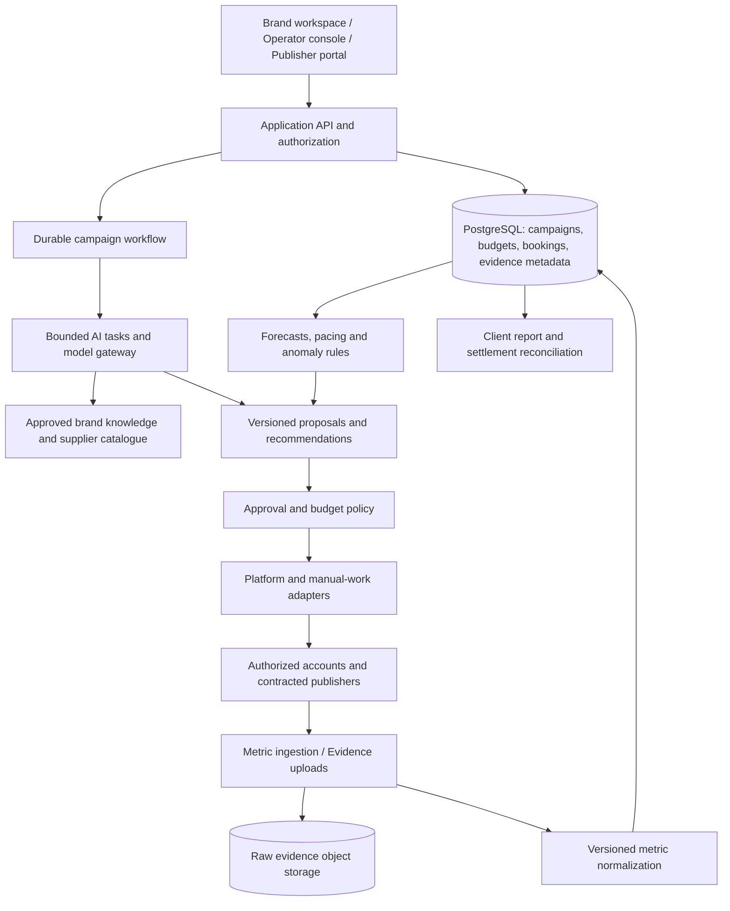

# Architecture and platform design

2026-11-02 · Proposed design; no production integration has been tested.

## 1. Architecture choice

Follow-up assessment: [Local agent fleet](04_local_agent_fleet.md) evaluates specialized 24/7 worker groups, authorized interaction, workload sizing, and why synthetic engagement should not count as delivery.

Build a **modular application with durable background workflows**, not an autonomous swarm controlling the business. Use agents for interpretation, drafting, comparisons, and recommendations. Keep permissions, budget limits, publication authorization, metric calculations, and settlement in deterministic application code.

Recommended initial components: React/TypeScript RTL web interface; Python API and workers for campaign logic and AI/data tasks; PostgreSQL as the system of record; S3-compatible storage for assets and evidence; a durable workflow engine for long-running campaign operations. Temporal is a candidate because it models durable workflow executions, but adopt it only if the team can operate it. A database-backed job system with explicit transitions is acceptable for a small pilot. [Temporal documentation](https://docs.temporal.io/workflow-execution)



Start with one deployment for the API and separately scalable workers. Do not introduce Kafka, a graph database, a feature store, or many microservices until workload and team needs justify them. Add columnar analytics storage later if metric-event volume makes PostgreSQL aggregation expensive. An embedding index can help retrieve approved documents; it is not the accounting database.

Provider availability is a procurement dependency. Use a model gateway so the product can run with an approved hosted provider or licensed, self-hosted open-weight models. Benchmark Persian quality, tool use, latency, and actual workload before buying GPUs. Self-hosting does not itself settle licensing, hardware supply, or regulatory questions.

## 2. Campaign state and financial control

Main lifecycle:

`draft → qualified → proposed → client_approved → funded → booking → scheduled → live → measuring → reconciled → closed`

Additional explicit states: `needs_revision`, `partially_booked`, `delivery_unknown`, `paused`, `disputed`, `cancelled`. Booking and creative approvals have their own versions. An accepted campaign plan is not permission for unlimited revisions or spend.

Before any external mutation, check tenant, actor, exact asset version, destination, approved time window, reserved budget, and scope. A revised asset requires reapproval when the policy says so. A retry after a timeout first checks for an existing remote result to avoid publishing or paying twice.

Maintain separate amounts for planned, reserved, committed, paid, refundable, refunded, and available budget. Never treat an invoice awaiting payment as free budget. Transactionally reserve spend before booking. Publishing and booking requests carry idempotency keys. Use an outbox to reliably hand committed database events to workers.

Automatic optimization may only use uncommitted or explicitly cancellable inventory within a preapproved envelope. A recommendation to move money cannot undo a fixed creator contract. Cancellation costs and supplier deadlines are inputs to optimization.

## 3. Minimum domain model

| Entity | Essential fields |
|---|---|
| Tenant / membership | Brand, agency relationship, role, approval scope |
| Brand profile | Verified product facts, prohibited claims, voice, approved sources, asset rights |
| Campaign | Objective, dates, timezone, status, budget currency, version |
| KPI contract | Platform metric, target, window, evidence grade, exclusions, remedy |
| Publisher / account | Ownership verification, platform/surface, category, capabilities, permissions |
| Inventory offer | Format, date/slot, price unit, capacity, cancellation and evidence terms |
| Creative / revision | Asset hash, parent variant, claims/sources, rights, approvals |
| Plan / line item | Chosen inventory, forecast range, price, assumptions, constraints |
| Booking / placement | Supplier acceptance, content revision, remote post ID, publication window |
| Metric observation | Native name, value, observation time, reporting interval, source, definition version |
| Evidence object | Object URI, content hash, capture method, submitter, review status |
| Ledger entry | Currency, amount, account, campaign/booking, external reference |
| Recommendation | Inputs, model/version, rationale, predicted impact, uncertainty, approval |
| Experiment | Hypothesis, assignment, variant, primary metric, stopping rule |
| Conversion | Event ID, campaign/click attribution, consent state, qualification, deduplication key |

Every entity that contains customer data carries a tenant boundary. Use application authorization and database row policies as complementary controls; use a non-owner application database role and verify isolation. PostgreSQL documentation notes that row security must be enabled and privileged roles can bypass it. [PostgreSQL row security](https://www.postgresql.org/docs/current/ddl-rowsecurity.html)

## 4. Measurement is the central technical product

Preserve native observations before normalization. Example:

```json
{
  "campaign_id": "campaign-demo",
  "placement_id": "placement-demo",
  "platform": "telegram",
  "native_metric": "post_views",
  "value": 42000,
  "observed_at": "2026-11-02T12:00:00Z",
  "count_mode": "cumulative",
  "definition_version": "telegram-post-view-v1",
  "source_kind": "publisher_export",
  "verification_status": "review_required",
  "evidence_id": "evidence-demo"
}
```

The value is illustrative. A platform-reported counter is evidence of a reported number, not proof that every exposure was human, unique, in Iran, or causally generated by the campaign.

### Evidence grades

- **A:** authorized first-party API or verified dashboard export, with account and asset binding.
- **B:** publisher-provided export/screen recording with corroborating post/account/time details and review.
- **C:** screenshot or public counter with limited corroboration; provisional, not equivalent to A.
- **D:** model estimate; never eligible as measured delivery.

Grades express provenance strength, not guaranteed absence of invalid traffic. Screenshots can be edited. Compare against publication IDs, historical trajectories, account baselines, and first-party destination traffic when possible. Anomaly flags create review tasks; they are not automatic accusations of fraud.

### Calculation rules

1. Store cumulative snapshots; do not sum them as if each snapshot were new views.
2. Retain corrections and deletions. Negative deltas may reflect platform corrections and need reconciliation.
3. Keep organic, paid, and combined counts separate; avoid counting both total and its subcomponents.
4. Do not add per-post reach and call it unique account reach. Do not add account reach across platforms and call it unique people.
5. Missing metrics are unknown, not zero. Freeze confidence when data is stale.
6. Report event time, retrieval time, and freshness. Define when provisional results become billable.
7. Count accepted conversions once using transaction/event IDs. Record attribution method and window; a tagged click is attribution evidence, not an incrementality experiment.

Use first-party tagged links and landing pages where possible, accounting for bot/link-preview requests and obvious duplicate events. Keep native impression/view targets distinct from off-platform visits. Destination metrics cannot retroactively prove all upstream views.

## 5. Forecasting and optimization

Start with robust historical baselines by publisher, format, sector, placement age, and price. Use conservative ranges and disclose sample size. Cold-start publishers use broad priors and small test budgets. Do not ask an LLM to invent a probability of virality.

Train a statistical forecast only when there is enough comparable data. Validate on future time windows and held-out campaigns, not random rows from the same campaign. Evaluate error and interval coverage by channel, supplier, and sector; show when coverage is inadequate. A numerical “90% probability” is not justified until calibration supports it.

For each separate eligible metric target, plan for the cost of delivery under uncertainty. Candidate planning objective:

`minimize expected eligible media cost + shortfall penalty + supplier-risk penalty`

Subject to total budget, confirmed capacity, channel target floors, approval, evidence grade, timing, brand suitability, and concentration constraints. Never trade away a required Instagram target merely because Telegram counters are cheaper.

Early optimization should be rules plus human review: missed placement, budget pacing, low delivery against comparable age curves, or stale evidence. Later use constrained allocation and controlled exploration on **new** placements. Correlated publisher outcomes and shared audience mean independent forecast assumptions can understate shortfall risk; use campaign-level scenarios and stress tests.

For creative tests predeclare the primary measure and comparison unit. Match or randomize comparable slots where possible; a different publisher/time can confound the result. Do not claim a creative caused better results from an uncontrolled before/after comparison. Brand-lift or incremental-sales claims need a separate holdout/research design.

## 6. Agent responsibilities

| Agent/task | Inputs and output | Boundary | Evaluation |
|---|---|---|---|
| Brief analyst | Client notes → structured objective, missing information | Cannot fabricate product facts or client approval | Extraction accuracy and missing-requirement detection |
| Research/planning assistant | Approved catalogue and history → ranked plan candidates | Must cite actual quotes; cannot invent inventory | Planner acceptance, feasible recommendations, preparation time |
| Creative adapter | Approved claims/assets → platform-specific variants | Rights and claims checks; human editorial approval | Persian quality, factual accuracy, real test outcomes |
| Operations assistant | Bookings/deadlines → handoffs, reminders, exception queue | Approved recipients and templates; no unauthorized commitments | Missed deadlines, operator minutes, duplicate actions |
| Measurement reviewer | Raw evidence → extracted fields and discrepancy flags | Cannot promote estimates to verified evidence | Extraction precision, false alarms, review time |
| Optimization assistant | Fresh metrics, budgets, constraints → proposed changes | Deterministic budget gate; no unrestricted buying | Validity of recommendations and measured business impact |
| Reporting assistant | Reconciled ledger/metrics → sourced client narrative | Every number generated from queries, not prose guesses | Numerical fidelity and reporting time |

These are bounded software tasks; they do not require seven independently chatting agents. Use one orchestrated workflow and specialist prompts/tools where that improves evaluation. Show users evidence, decisions, approvals, and concise rationales, not theatrical internal deliberation.

Treat publisher pages, uploaded documents, captions, and comments as untrusted data. They must not override instructions or trigger credential disclosure. Keep secrets in connector services, outside model prompts. Tool calls use typed schemas, allowlists, per-tenant scopes, timeouts, and cost limits.

## 7. Platform experience

Three roles need distinct working views:

**Brand workspace:** objective, approved plan, creative preview, delivery progress per KPI, evidence drilldown, decisions awaiting approval, invoice/report.

**Operations console:** clients, supplier catalogue, booking calendar, campaign exceptions, evidence queue, budget commitments, settlement.

**Publisher portal:** offered placements, clear briefs, accept/decline, content/version approval, publication confirmation, evidence submission, payment status.

Proposed Persian navigation:

| Screen | Main decision |
|---|---|
| خانه / Home | What needs attention today? |
| کمپین‌ها / Campaigns | Which targets are on track, at risk, or unmeasurable? |
| برنامه رسانه / Media plan | Where should we spend, based on what evidence? |
| استودیو / Studio | Which asset/version is approved for each placement? |
| رسانه‌ها / Publishers | Who can deliver the needed placement and evidence? |
| تأییدها / Approvals | What exact commitment am I approving? |
| نتایج و شواهد / Results and evidence | What was delivered and how do we know? |
| مالی / Finance | What is committed, payable, refundable, and remaining? |
| قطب‌نمای برند / Brand Compass | Which facts, voice, audiences, and constraints steer the work? |

The target wizard asks: desired business result → primary metric → audience/context → deadline → budget → channel preferences → evidence/commitment level. It returns conservative, balanced, and experimental scenarios with explicit assumptions. Unsupported targets are explained before checkout.

A campaign page should show separate progress bars for each metric, evidence freshness, committed versus free budget, forecast ranges, and the next recommended action. A chat drawer can explain results, but core workflows must remain usable without chatting.

Reuse the existing Compass as Brand Compass, Studio for format adaptation, and approvals. Replace political missions with campaign objectives. Make listening optional research context. Retire synthetic-electorate predictions, attack forecasting, and unsupported virality scores from the commercial pitch.

## 8. Connector contract and resilience

Each adapter declares capabilities independently: `publish`, `edit`, `delete`, `fetch_metrics`, `book_inventory`, `cancel_booking`, `upload_evidence`, plus allowed media types, authentication, freshness, and known limitations. A manual adapter creates assigned tasks with deadlines and requires confirmation; it is a first-class workflow, not a false API success.

Use bounded retries, rate-limit handling, circuit breakers, webhook verification, deduplication, and dead-letter review. After an ambiguous publish response, check for the remote post before retrying. During a network outage, pause dependent actions and mark measurements stale. Do not automatically divert a client's budget to a domestic channel with a different audience without approved fallback rules.

Store UTC timestamps and display Asia/Tehran; support Persian calendar presentation. Persist money in an explicit canonical currency/unit using integers or fixed decimals. Label rial/toman conversions visibly and consistently. Quote validity, taxes, and payment terms must be configurable rather than hidden in a conversion assumption.

## 9. Build sequence and acceptance gates

Schedule estimates assume two experienced engineers, a product/AI lead who can contribute technically, a media operator, and part-time design/QA. They are planning assumptions, not vendor quotes. App approval and supplier access can extend elapsed time.

| Phase | Estimated duration | Deliverable | Gate |
|---|---|---|---|
| Access and commercial discovery | 2 weeks | Historical campaign sample, supplier quotes, measurement definitions, account tests | Paying pilot candidates and at least two viable distribution routes |
| Concierge pilot tooling | 3–4 weeks | Brief, plan, assets, approval, manual bookings, evidence, reports | End-to-end campaign reconciliation with real data |
| Connected MVP | Additional 4–6 weeks | Tested integrations for 2–3 chosen channels, durable workflows, ledger, pacing | Safe retries, tenant isolation, numeric report fidelity, evidence completeness |
| Forecasting and bounded optimization | After sufficient campaigns | Evaluated estimates and recommendation loop | Beats baseline or demonstrably reduces work without worsening outcomes |
| Broader platform | Demand/data dependent | Supplier onboarding, more channels, white-label options | Repeat purchase and sustainable contribution margin |

Suggested verification scenarios: timeout after remote publication; duplicate webhook; budget race between two bookings; revised asset after approval; metric corrected downward; supplier posts wrong content; account permission revoked; evidence arrives late; one tenant requests another's data; malicious instructions embedded in a publisher page.

Operational targets to agree during discovery: no unapproved spend; no duplicate publication in failure tests; every billed placement has contract-acceptable evidence; every report number traces to a query and source; recoverable daily backups with a tested restore. Performance/uptime targets should follow actual campaign needs rather than arbitrary enterprise promises.
